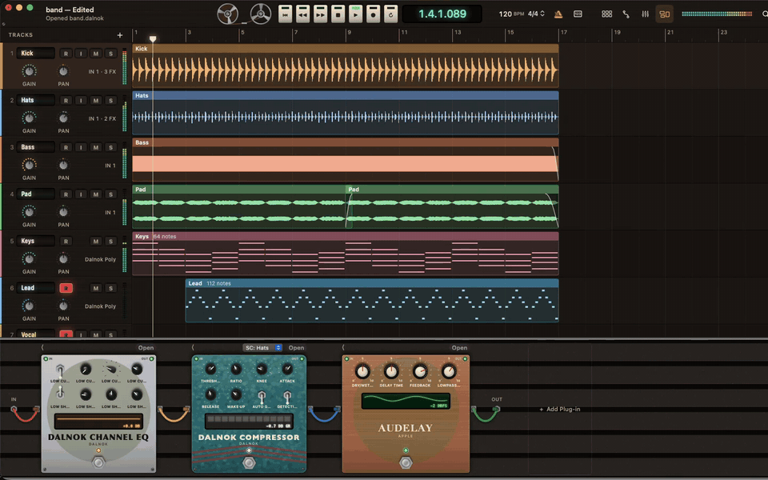
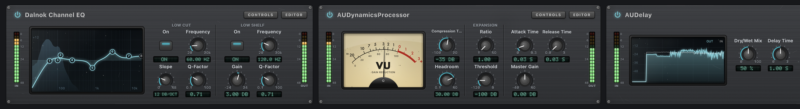
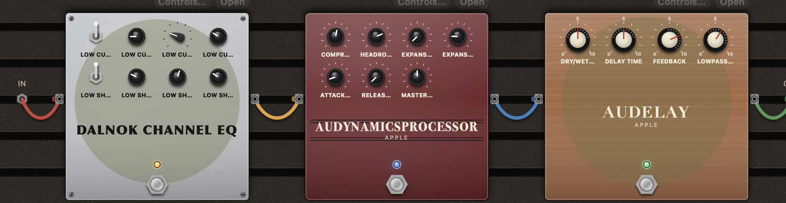
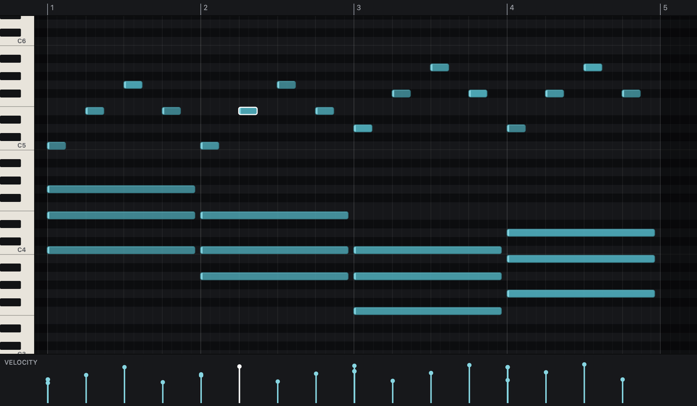
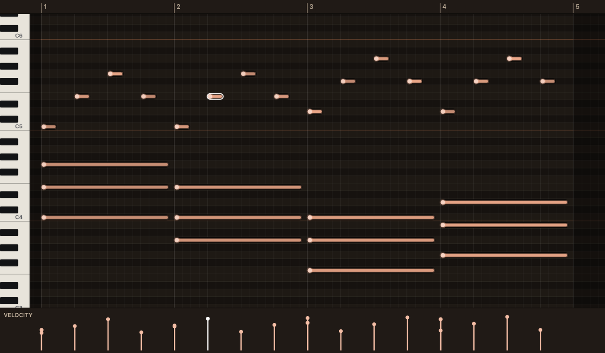
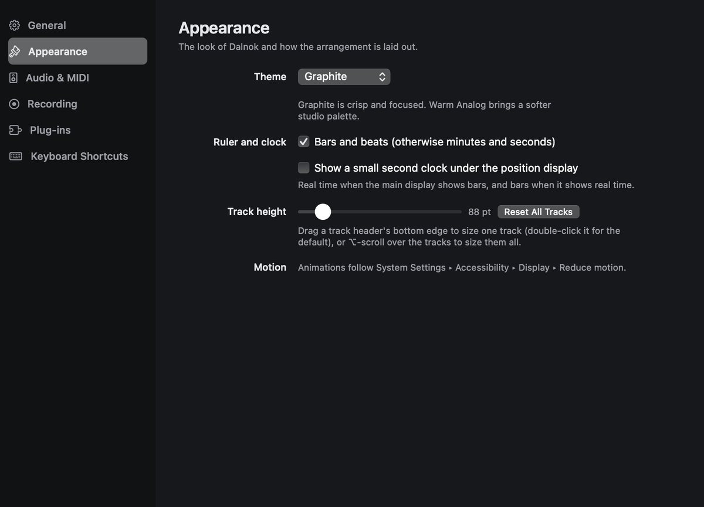

# Dalnok

An open-source digital audio workstation for macOS (and later Windows and Linux). The goal is pro-grade
recording, editing, and mixing in a fast, focused native app.

> **Feature parity tracker:** https://droper23.github.io/dalnok-status/
>
> **Status: 0.1.0, first preview release (pre-alpha).** Expect rough edges and save often.
> What works and what doesn't is in [CURRENT_STATE.md](CURRENT_STATE.md); changes are in [CHANGELOG.md](CHANGELOG.md).


## What's in 0.1.0
- **Recording and editing:** multi-track audio recording with cycle, punch and count-in, take folders with swipe
  comping, crash-safe capture and recovery, clip fades and gain, time-stretch and pitch.
- **MIDI:** MIDI clips, a piano roll with velocity and quantize, live MIDI input and recording, the built-in Dalnok Poly
  synth, tempo and meter maps, a metronome.
- **Mixing:** buses, sends, a mixer with a master strip and inserts, volume, pan and plug-in automation (Touch/Latch),
  plug-in delay compensation, track stacks.
- **Plug-ins:** VST3, CLAP and Audio Units, each validated in a separate scanner process before use; a plug-in browser
  sorted by what each plug-in declares, its name and its parameters; sidechains. In the Graphite appearance every
  plug-in gets a hardware-style faceplate with a display that suits it (VU gain reduction, an EQ screen with draggable
  bands, transfer curve, goniometer and more).
- **Built-in effects:** Dalnok Channel EQ, matching Logic's Channel EQ.
- **Moving from another DAW:** imports Logic Pro, Ableton Live, REAPER and Final Cut XML projects, or a folder of stems,
  with a report of what came across.
- **Clip launcher** with scenes on the same tracks as the arrangement.
- Two appearances: **Graphite** and **Warm Analog**, resizable tracks, and one Settings window for every preference
  (keyboard shortcuts included).

## Screenshots
Two appearances, the same app. **Graphite** draws every plug-in as a hardware unit with a display that suits it;
**Warm Analog** turns them into pedals patched with cables, beside a tape transport.

<table>
<tr><td align="center"><br><sub>Graphite</sub></td>
<td align="center"><br><sub>Warm Analog</sub></td></tr>
</table>

### Plug-in faceplates (Graphite)
Drag an EQ's bands on its screen; dynamics get a VU gain-reduction meter, distortion a transfer curve, delays an
energy history. Bypassed units sit back with their lights off, and Settings can age them with scratches and dust.



### Warm Analog


<table>
<tr><td width="58%"></td>
<td width="42%"></td></tr>
</table>

### MIDI and settings
<table>
<tr><td align="center"><br><sub>Piano roll, Graphite</sub></td>
<td align="center"><br><sub>Piano roll, Warm Analog</sub></td></tr>
<tr><td colspan="2" align="center"><br><sub>Settings</sub></td></tr>
</table>

All screenshots and animations come from the real app with generated projects (`scripts/make-test-project.sh`,
`Dalnok <project> --tour <dir>`), using Dalnok's own and Apple's built-in plug-ins.

## Install (preview build)
Download `Dalnok-0.1.0.zip` from the [Releases](https://github.com/droper23/dalnok/releases) page, unzip it and move
`Dalnok.app` to Applications. Requires macOS 14 or later on Apple Silicon.

The preview build is not notarized yet. The first time, right-click `Dalnok.app` and choose **Open**, then confirm.
(Or run `xattr -dr com.apple.quarantine /Applications/Dalnok.app`.)

## Build & run (macOS 14+, Apple Silicon)
```sh
xcode-select --install        # or a full Xcode 16+ install
swift build                   # engine + app + CLI
swift run Dalnok              # launch; drop audio files on the window or press ⌘I
swift test                    # engine test suite
scripts/check.sh              # build + tests + live audio smoke test
scripts/bundle.sh             # dist/Dalnok.app
```
No third-party dependencies are needed for the current build.

## Architecture in one paragraph
A C++20 engine (`engine/`) owns the real-time audio path, media decoding, and offline rendering, and
exposes a small C API (`engine/include/dalnok/dalnok.h`). The macOS UI (`app/macos/`) is native AppKit.
The audio callback is checked for real-time safety at compile time (`[[clang::nonblocking]]`). Details are
in [`03 - Architecture/System Overview.md`](<03 - Architecture/System Overview.md>).

## License
GPL-3.0-or-later. See [LICENSE](LICENSE) and [`04 - Research/Licensing.md`](<04 - Research/Licensing.md>).
